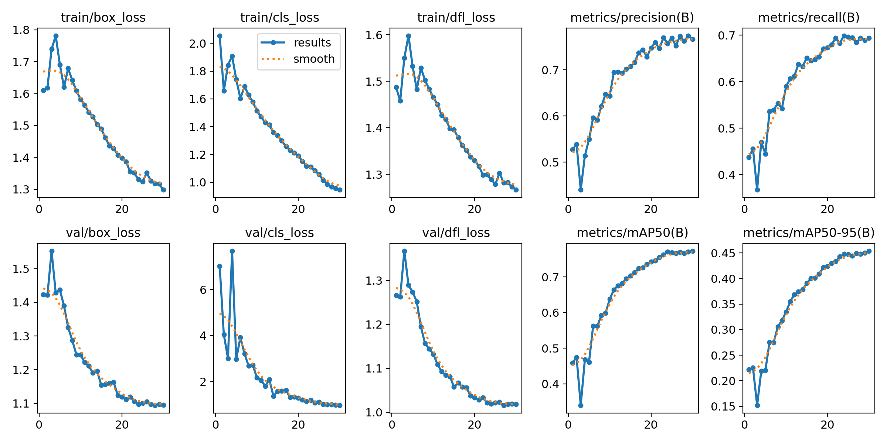
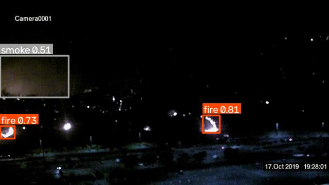
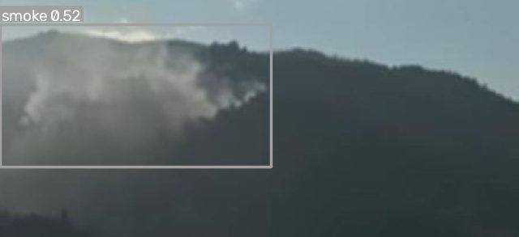
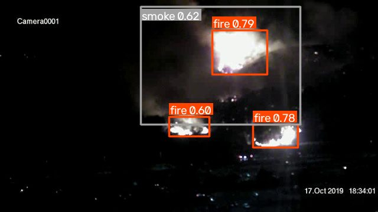
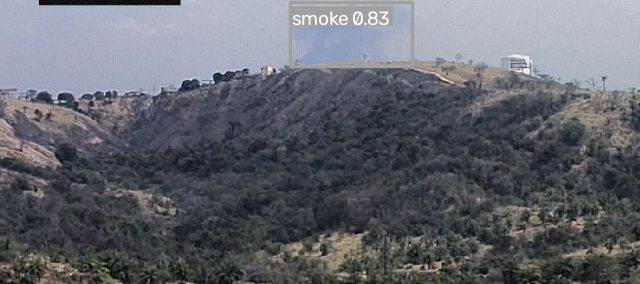

# firewatch

Fire and smoke detection on IP camera streams and video files. A YOLO11s model trained on the
open D-Fire dataset runs through onnxruntime at inference time, without PyTorch. When a detection
holds steady, the service sends an annotated frame to Telegram, saves a snapshot and a short
clip of the event. There is also an HTTP API for checking single images. It is meant for places
where cameras are already installed and smoke detectors don't cope: high ceilings, open areas.

## Results

YOLO11s (COCO pretrained), 640x640, 30 epochs on an RTX 2060 6 GB, the best epoch is the last one
(mAP50 0.773 on val, [docs/results.csv](docs/results.csv)). Official D-Fire test set, `best.pt`
through `ultralytics val` ([docs/test_metrics_pt.json](docs/test_metrics_pt.json)):

| Class | Images | Instances | Precision | Recall | mAP50 | mAP50-95 |
|-------|--------|-----------|-----------|--------|-------|----------|
| all   | 4306 | 5189 | 0.759 | 0.687 | 0.760 | 0.436 |
| fire  | 1115 | 2878 | 0.718 | 0.616 | 0.703 | 0.367 |
| smoke | 2081 | 2311 | 0.800 | 0.758 | 0.817 | 0.506 |

### Test without train copies (ONNX)

These numbers are inflated: many test frames come from the same videos as train. By dHash (64 bits),
23.1% of test images have a train frame at distance 0 bits, and 40.5% have one within 2 bits.
`scripts/dedup_test.py` keeps only the images that are at least 7 bits away from everything in train
([docs/dedup_test.json](docs/dedup_test.json)). On the full test set ONNX loses 0.002 mAP50
to `best.pt` because of the square input ([docs/test_metrics_onnx.json](docs/test_metrics_onnx.json)).

| Test | Images | mAP50 | mAP50-95 | fire mAP50 / 50-95 | smoke mAP50 / 50-95 |
|------|--------|-------|----------|--------------------|---------------------|
| full | 4306 | 0.758 | 0.432 | 0.699 / 0.365 | 0.816 / 0.499 |
| without train copies | 1962 | 0.731 | 0.416 | 0.646 / 0.316 | 0.816 / 0.517 |

Per single frame at the default thresholds (fire 0.40, smoke 0.50), without the N-of-M window, fire
is found in 82.4% of 1115 frames that contain it, smoke in 72.8% of 2081, and a false alarm is raised
on 0.5% of 2005 empty frames. Without train copies it is 79.5% of 711, 77.5% of 1182 and 1.0% of 699.

Per box on the full test set, fire is weaker than smoke: recall 0.51 vs 0.62, mAP50 0.70 vs 0.82,
mostly because of size: 18% of fire boxes have a long side under 20 px at the 640 input. At the
default thresholds and IoU with a prediction of 0.5, 24% of 526 such boxes are found, and 64% of 1014
boxes from 64 px; with a size distribution like smoke's, fire recall would be ~0.60 ([docs/recall_by_size.json](docs/recall_by_size.json)).
The labeling hurts too: neighboring fires are outlined sometimes with one box, sometimes with several.



### Speed (ONNX)

`scripts/benchmark.py`: letterbox, inference, NMS and coordinate conversion, 100 test images,
batch 1, FP32, onnxruntime 1.23.2, Windows 10 ([docs/bench.json](docs/bench.json)).

| Device | Provider | pre / inference / post, ms, mean | total, ms, p50 / p95 | FPS from mean |
|--------|----------|----------------------------------|----------------------|---------------|
| Intel Core i5-10400F | CPU | 3.2 / 90.4 / 0.3 | 94.0 / 99.6 | 10.6 |
| NVIDIA RTX 2060 6 GB | CUDA | 2.9 / 8.9 / 0.3 | 12.0 / 12.6 | 83.0 |

Not every frame needs to be looked at: at 25 FPS and `process_every: 3` that is ~8 inferences per second,
which the i5-10400F handles for one camera; with `process_every: 10` it should handle 3-4 cameras
by estimate, beyond that you need a GPU.

`scripts/check_onnx.py` compares the export with the original on 50 test images: the raw network
output differs by at most 0.0066 px, and `OnnxDetector` and ultralytics on the same .onnx
find the same 64 boxes ([docs/check_onnx.json](docs/check_onnx.json)). With .pt the
match is worse: ultralytics finds 62 boxes, `OnnxDetector` 64, and for the matched ones the mean IoU is
0.971, the worst 0.57. For .pt, ultralytics pads the frame to a rectangle that is a multiple of 32, not
to a square, and the boxes that differ are borderline ones with a score near the conf threshold.

| ONNX, test without train copies, threshold 0.4 | |
|---|---|
|  |  |
|  |  |

## Installation

Needs Python 3.10+. The onnxruntime and OpenCV builds conflict with each other, so you pick an
extra: `cpu` for a server, `gpu` for a machine with a graphics card. The weights are not stored in the
repository; the script takes the ONNX file from [Releases](https://github.com/leskoont/firewatch/releases) and checks its sha256.

```bash
python -m venv .venv
.venv\Scripts\activate              # Linux: source .venv/bin/activate
pip install -e ".[cpu]"             # runtime only
pip install -e ".[gpu,train,dev]"   # GPU, ultralytics for training, pytest
python scripts/download_weights.py  # -> models/firewatch-yolo11s.onnx
```

`gpu` installs `onnxruntime-gpu` with CUDA and cuDNN from pip; no system CUDA Toolkit is needed, only
the NVIDIA driver. If CUDA fails to start, the log gets a warning and it runs on CPU.
On Windows, onnxruntime crashes on import under the base environment of an old Anaconda with its outdated
`msvcp140.dll`; a regular Python from python.org works.

## Data and training

[D-Fire](https://github.com/gaiasd/DFireDataset): 21 527 images, classes `smoke` and `fire`,
YOLO labels, CC0 1.0. `scripts/prepare_dfire.py` takes it from a Hugging Face mirror
([badsaarow/d-fire](https://huggingface.co/datasets/badsaarow/d-fire), ~3.1 GB; the original on
OneDrive can't be downloaded without a browser), shrinks the images to 640 px on the long side and writes
`data/dfire/dfire.yaml`. The official test set is left untouched, val (10%) is split from train by a hash of
the file name: 15 508 / 1 713 / 4 306 images, with 2 005 in the test set containing no fire or smoke. Boxes with a
side under 0.1% of the frame are dropped as labeling errors.

```bash
python scripts/prepare_dfire.py
python scripts/train.py                              # configs/train.yaml
python scripts/train.py --keep-cuda-cache --resume runs/yolo11s-dfire/weights/last.pt batch=8 workers=3
python scripts/evaluate.py runs/yolo11s-dfire/weights/best.pt --split test --out docs/test_metrics_pt.json
python scripts/export_onnx.py runs/yolo11s-dfire/weights/best.pt   # -> models/firewatch-yolo11s.onnx
python scripts/check_onnx.py runs/yolo11s-dfire/weights/best.pt models/firewatch-yolo11s.onnx
python scripts/recall_by_size.py models/firewatch-yolo11s.onnx --out docs/recall_by_size.json
python scripts/benchmark.py models/firewatch-yolo11s.onnx --providers cpu cuda
```

On 6 GB under Windows, training crashed with CUDA OOM at epoch boundaries: after validation ultralytics
calls `torch.cuda.empty_cache()`, and under WDDM the memory can't always be allocated again afterwards. Epochs 1-6
ran with batch 12, the rest with batch 8, workers 3 and `--keep-cuda-cache`, which disables that call.
The export is static (1x3x640x640, opset 17), with no NMS in the graph: postprocessing is in numpy in
`firewatch/ops.py`. The input size is read from the graph's input shape, the class names from the ONNX metadata.

## Running

```bash
firewatch detect path/to/images "shots/*.jpg" -o runs/detect   # no image could be read - exit code 1
cp configs/cameras.example.yaml configs/cameras.yaml
cp .env.example .env                                           # bot token, chat_id, camera logins
firewatch run -c configs/cameras.yaml
```

All keys are explained in `configs/cameras.example.yaml`. A camera source is a file path,
an RTSP/HTTP URL or a webcam number. `${VAR}` and `${VAR:-default}` are substituted from the environment and
`.env`. `camera_defaults` apply to all cameras and any key can be overridden per camera,
thresholds are merged per class, and `smoke: null` on a camera turns smoke off for it.

An unknown key, an empty name or source, two names that map to the same event file (`Gate` and `gate`),
or a threshold for a class the model doesn't have is an error at startup. Field values are not
printed in the message, so passwords don't leak.

The model looks at every `process_every`-th frame; a live stream is read in a separate thread and
the most recent frame is taken, so slow inference doesn't build up latency. A class raises an
alarm if it passed the threshold in at least `min_hits` of the last `window` processed frames: this
filters out glare and flashing lights. After that the class stays silent on that camera for `cooldown_s` seconds.

RTSP is read through FFmpeg over TCP, and a 640x360 or 704x576 substream is enough for the model. A dropped
stream is reopened after `reconnect_delay_s`, and camera state is visible at `/cameras`. Passwords in
URLs are masked in logs and in the API. `#`, `?` and `/` in a password are written as `%23`, `%3F` and `%2F`,
otherwise FFmpeg cuts the address off; the config warns about unencoded ones at startup.

Telegram gets a snapshot with boxes and the caption `[warehouse] fire 0.82, smoke 0.61` with the time
on the second line, and at startup a message with how many cameras were started. If the snapshot fails to go through, a
text message is sent instead, and on a 429 `retry_after` is honored. You can find your `chat_id` with @userinfobot.

Sending goes through a separate queue of 20 alarms: when it overflows, the oldest are dropped,
an alarm older than 10 minutes is not sent, and an undelivered one is logged as ERROR.

Snapshots and clips (3 s before and 5 s after the alarm) are saved to `events/`. The clip is written as H.264
if OpenCV can do that, otherwise as mp4v (the order is set by `FIREWATCH_CLIP_CODECS`). OpenCV wheels
for Linux can't write H.264, so Docker uses mp4v right away: VLC opens it, but a browser doesn't.

## API

It starts together with `firewatch run` (if `api.enabled`) or separately: `firewatch serve`.

```bash
curl http://localhost:8000/health
curl -F "file=@data/dfire/images/test/AoF07841.jpg" "http://localhost:8000/detect?conf=0.4"
curl http://localhost:8000/cameras
```

```json
{"width":640,"height":360,"inference_ms":97.1,"detections":[
  {"label":"fire","class_id":1,"score":0.8061,"box":[394.1,225.0,427.2,258.9]},
  {"label":"fire","class_id":1,"score":0.73,"box":[0.2,245.2,28.5,269.3]},
  {"label":"smoke","class_id":0,"score":0.5087,"box":[0.2,108.7,133.9,189.4]}]}
```

`box` is in pixels of the original image, x1, y1, x2, y2; the time here is on CPU. A body over 20 MB
gets 413, and an image over 40 Mpx is rejected from the header, before decoding. There is no authentication,
so expose the API outside only through a proxy.

`/health` returns `status` and the number of running cameras in `cameras`; with all cameras disabled
it is `0` and 200. If a camera hasn't sent frames for more than a minute, the response is 503 with status `degraded`
and a `stale` list. A video without `loop` that has been read to the end doesn't count as stuck.

## Docker

```bash
mkdir -p events && docker compose up -d --build   # after download_weights.py, cameras.yaml and .env
```

The image uses the CPU build of onnxruntime, without PyTorch. The model, config, `events/` and `data/videos/`
are mounted as volumes, the API listens only on 127.0.0.1, and the process (uid 1000) needs write access to `events/`.

## Tests

`pytest` and `ruff check .`. A trained model isn't needed: for the detector and API a tiny
ONNX graph with a known output is built, and Telegram requests are replaced with `httpx.MockTransport`.

## Limitations

- False positives on fire: sunsets, orange light, brake lights, flashing lights, signs.
  The N-of-M window removes flashes but not a static orange scene.
- The model confuses fog, steam and dust with smoke, and often misses thin smoke in the distance.
- Fires smaller than 20 px on a 640 frame are found in 24% of cases. Not tested on night IR frames.
- Thresholds and `min_hits` need to be tuned on recordings from the specific cameras. This does not replace an alarm system.

## License

AGPL-3.0, (c) 2025 Max Nikonov, see [LICENSE](LICENSE): the model was trained and exported with
Ultralytics (AGPL-3.0), and under their terms the weights and the code that uses them inherit the license. For
closed commercial use you need an Ultralytics Enterprise license or a model from a different stack.

The D-Fire dataset (CC0 1.0): de Venâncio, Lisboa, Barbosa, Neural Computing and Applications, 2022.
The examples in `docs/` are taken from `AoF*`, the authors' own cameras; `PublicDataset*` have their own rights holders.
